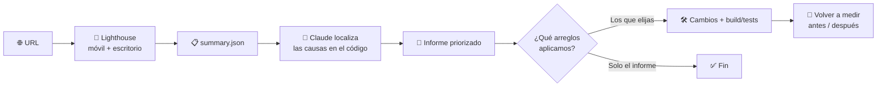

<div align="center">

# ⚡ pagespeed-audit

**Una skill para Claude que convierte una URL en un informe de rendimiento claro y en cambios reales en tu código.**

Analiza cualquier web con Lighthouse, el motor de Google PageSpeed Insights. Te dice qué arreglar primero, cuánto cuesta y qué se gana. Si quieres, Claude aplica los arreglos que elijas.


[](LICENSE)

[Qué hace](#-qué-hace) · [Instalación](#-instalación) · [Uso](#-uso) · [El informe](#-el-informe) · [Ejemplo](#-ejemplo) · [Línea de comandos](#️-línea-de-comandos) · [Preguntas frecuentes](#-preguntas-frecuentes)

</div>

---

## ✨ Qué hace

Le pides a Claude *"analiza https://miweb.com con PageSpeed"* y la skill:

1. **📏 Mide** la web en móvil y escritorio: rendimiento, accesibilidad, buenas prácticas y SEO.
2. **🔎 Busca la causa** de cada problema. Si estás en la carpeta del proyecto, lo relaciona con el archivo y la línea donde está.
3. **📝 Escribe un informe** pensado para personas: veredicto, plan de acción priorizado, una ficha por arreglo con el código antes y después, y lo que *no* merece la pena hacer.
4. **🛠️ Aplica los arreglos que elijas**, comprueba que el proyecto sigue compilando y vuelve a medir para enseñarte el antes y el después.

|  | |
|---|---|
| 💸 **Gratis** | Sin API key, sin cuenta y sin cuotas. Lighthouse se ejecuta en tu equipo. |
| 🏠 **Mide localhost** | Comprueba las mejoras antes de desplegar. |
| 🎯 **Prioriza de verdad** | No repite el orden de Lighthouse: cruza impacto, dificultad y tiempo, y dice qué *no* hacer. |
| 🧑‍💼 **Lo entiende cualquiera** | Lenguaje llano, iconos con significado fijo y glosario. Se puede pasar tal cual a un cliente. |
| 🔒 **Tú decides** | No toca el código hasta que elijas, y nunca hace commit, push ni despliega sin que se lo pidas. |
| 🧩 **Sin dependencias** | El script solo usa la biblioteca estándar de Python. |

## 🔄 Cómo funciona



## 📦 Instalación

### Requisitos

| | Versión | Para qué |
|---|---|---|
| [Python](https://www.python.org) | 3.8 o superior | Ejecutar el script de medición |
| [Node.js](https://nodejs.org) | 18 o superior | Ejecutar Lighthouse con `npx` (se descarga solo la primera vez) |
| [Google Chrome](https://www.google.com/chrome/) | Reciente | Lighthouse lo usa en modo headless |

### Claude Code

Para todos tus proyectos:

```bash
git clone https://github.com/AngelSamuel/pagespeed.git ~/.claude/skills/pagespeed-audit
```

Solo para un proyecto (y compartirla con el equipo a través del repositorio):

```bash
git clone https://github.com/AngelSamuel/pagespeed.git .claude/skills/pagespeed-audit
```

### Claude Desktop y Claude.ai

1. Descarga el repositorio como ZIP: **Code → Download ZIP**.
2. En Claude, ve a **Ajustes → Capacidades → Skills** y sube el ZIP.

> Para que la skill mida, el entorno donde se ejecuta Claude necesita Node.js y Chrome. En Claude Code se usa tu propio equipo.

### Actualizar

```bash
git -C ~/.claude/skills/pagespeed-audit pull
```

### Comprobar que funciona

```bash
python3 ~/.claude/skills/pagespeed-audit/scripts/run_pagespeed.py https://example.com --strategy mobile
```

Debería terminar con una línea parecida a `mobile: performance=100, accessibility=100, …`.

## 🚀 Uso

Abre Claude en la carpeta del proyecto web y pídelo con tus palabras. No hace falta nombrar la skill: se activa cuando hablas de velocidad, PageSpeed, Lighthouse o Core Web Vitals.

| Lo que dices | Lo que pasa |
|---|---|
| *"Analiza https://miweb.com con PageSpeed"* | Mide, escribe el informe y te pregunta qué arreglos aplicar |
| *"¿Por qué mi web va lenta en el móvil?"* | Igual, centrado en lo que afecta al móvil |
| *"Hazme solo el informe de https://cliente.com, no tengo el código"* | Informe con las líneas del HTML publicado y las instrucciones para el servidor que usa la web |
| *"Mide http://localhost:3000 antes de desplegar"* | Mide tu build local |
| *"Aplica el 1, el 3 y el 5"* | Aplica solo esos arreglos, ejecuta build y tests, y vuelve a medir |
| *"Vuelve a medir y compara con el informe anterior"* | Añade al informe una tabla de antes y después |

<details>
<summary><b>Ver una sesión de ejemplo</b></summary>

```text
Tú:     analiza https://miweb.com con pagespeed

Claude: Analizando https://miweb.com (móvil y escritorio)…

        Veredicto: 🟠 Mejorable. Rendimiento 🟠 72 en móvil y 🟢 95 en escritorio.
        El principal problema es la imagen del hero (1,8 MB), que retrasa el LCP a 4,1 s.
        Informe: pagespeed-informe-miweb.com-2026-11-15.md

        ¿Qué arreglos aplico?
        [x] 1. 🔥 Optimizar la imagen del hero (🟢 Fácil · ~30 min)
        [x] 2. 🔥 Cargar en diferido las imágenes de abajo (🟢 Fácil · ~15 min)
        [ ] 3. 📌 Retrasar el chat de soporte (🟡 Media · ~1 h)
        [ ] Solo el informe

Tú:     1 y 2

Claude: Aplicados. El build pasa sin errores.
        LCP en móvil: 4,1 s → 2,2 s ✅ · Rendimiento: 72 → 91 🟢
        No he hecho commit: los cambios están listos para que los revises.
```

</details>

## 📊 El informe

Se guarda como `pagespeed-informe-<dominio>-<fecha>.md`, en la raíz del proyecto. Es Markdown, así que se ve con formato en GitHub, VS Code, Notion o cualquier visor. Va en capas: arriba lo que necesita quien decide y abajo lo que necesita quien hace los cambios.

| Sección | Contenido |
|---|---|
| 🧭 **Resumen** | Veredicto, estado general en 2-4 frases y la acción con más impacto |
| 📊 **Puntuaciones** | Las cuatro categorías, en móvil y en escritorio |
| ⏱️ **Core Web Vitals** | LCP, TBT, CLS y FCP explicados en lenguaje llano, con el objetivo de cada uno |
| 📦 **Peso de la página** | Reparto por tipo de recurso con barras, y los archivos más pesados |
| 🎯 **Plan de acción** | Tabla con prioridad, dificultad, tiempo, responsable y mejora esperada, más los arreglos rápidos |
| 🛠️ **Fichas** | Qué pasa, dónde, cómo arreglarlo (código antes y después), qué se gana y qué vigilar. Los arreglos de servidor y CDN llevan instrucciones para la plataforma detectada (nginx, Apache, Plesk, Cloudflare, Fastly…) |
| 🚫 **Lo que no haríamos** | Lo que Lighthouse marca pero no compensa, y por qué |
| 📝 **Notas** | Limitaciones de la medición y enlace a los datos de usuarios reales en PageSpeed Insights |
| 📖 **Glosario** | Siglas explicadas para quien no es técnico |

### Leyenda de iconos

Cada icono significa siempre lo mismo, para que el informe se pueda leer de un vistazo:

| | | |
|---|---|---|
| **Puntuación** | 🟢 90-100 · 🟠 50-89 · 🔴 0-49 | Los mismos umbrales que Google |
| **Core Web Vitals** | ✅ Bueno · ⚠️ Mejorable · ❌ Malo | Según los umbrales oficiales |
| **Prioridad** | 🔥 Hacer ya · 📌 Planificar · 💤 No prioritario | Impacto real comparado con el esfuerzo |
| **Dificultad** | 🟢 Fácil · 🟡 Media · 🔴 Difícil | Riesgo y alcance del cambio |
| **Quién** | 👩‍💻 Desarrollo · 🖥️ Hosting · ✍️ Contenido · 🤝 Cliente | Quién tiene que hacerlo |

## 👀 Ejemplo

[**📄 Ver un informe completo de ejemplo →**](examples/theguardian.com-2026-11-15.md)

Generado con esta skill sobre una web pública de terceros, solo para enseñar el formato. Así empieza el plan de acción:

> **Veredicto: 🟠 Mejorable** · Rendimiento 🟠 87 en móvil / 🟢 96 en escritorio
>
> 💡 **Lo más importante:** comprimir el HTML con Brotli en la CDN (#1). Es el primer archivo que necesita el móvil y, según nuestra prueba, pasaría de unos 152 KB a unos 93 KB.

| # | Arreglo | Prioridad | Dificultad | Tiempo | Quién | Mejora esperada |
|:-:|---|:-:|:-:|:-:|:-:|---|
| 1 | Comprimir el HTML con Brotli en Fastly | 🔥 Hacer ya | 🟡 Media | ½ día | 🖥️ | −60 KB de HTML (nuestra medición) · FCP y LCP móvil |
| 2 | Dar prioridad alta a la imagen del LCP | 🔥 Hacer ya | 🟡 Media | ½ día | 👩‍💻 | LCP móvil (Lighthouse no lo cuantifica) |
| 3 | Evitar que el aviso de consentimiento descargue otra copia de las fuentes | 🔥 Hacer ya | 🟡 Media | 2-4 h | 👩‍💻 🤝 | −162 KB de fuentes y −28 KB de logos en la primera visita |
| 4 | Corregir la cabecera `Link` y recortar los `preconnect` | 🔥 Hacer ya | 🟢 Fácil | ~30 min | 👩‍💻 | Quita el aviso de Lighthouse · 6 conexiones anticipadas sin usar menos |
| 5 | Poner nombre a los botones de reproducir vídeo | 🔥 Hacer ya | 🟢 Fácil | ~30 min | 👩‍💻 | Con #6: accesibilidad escritorio 92 → 100, móvil 89 → 96 |
| 6 | Corregir la lista del carrusel de destacados | 🔥 Hacer ya | 🟢 Fácil | ~30 min | 👩‍💻 | Ver #5 |
| 7 | Quitar `role="menubar"` del menú de navegación | 🔥 Hacer ya | 🟢 Fácil | ~1 h | 👩‍💻 | Con #5 y #6: accesibilidad móvil → 100 |
| … | *4 arreglos más* | | | | | |

> ⚡ **Quick wins** (menos de 30 min cada uno): #4, #5, #6, #8. Juntos llevarían la accesibilidad de escritorio a 100, la de móvil a 96 y el SEO a 92 (cálculo con los pesos de Lighthouse), sin cambios visibles.

## ⌨️ Línea de comandos

Puedes ejecutar la medición sin Claude, por ejemplo en CI o para ver las notas rápidamente:

```bash
python3 scripts/run_pagespeed.py <url> [--strategy mobile|desktop|both] [--out DIR] [--locale es]
```

| Opción | Por defecto | Descripción |
|---|---|---|
| `url` | — | Web a analizar. Si falta el protocolo, se usa `https://`. Acepta `localhost`. |
| `--strategy` | `both` | `mobile`, `desktop` o `both` |
| `--out` | `./pagespeed-report` | Carpeta de salida |
| `--locale` | `es` | Idioma de los textos de Lighthouse |

**Salida:**

| Archivo | Contenido |
|---|---|
| `summary.json` | Resumen compacto para Claude: notas, métricas con su valor exacto, elemento LCP, peso por tipo, peticiones más pesadas, auditorías que fallan (con los archivos, selectores y tamaños afectados) y auditorías que pasan |
| `raw-mobile.json` / `raw-desktop.json` | Informe completo de Lighthouse (LHR), por si hace falta un detalle |

La versión de Lighthouse está fijada (`lighthouse@13.6.0`), así que los resultados son reproducibles entre equipos.

## 🔒 Qué hace y qué no

- ✅ Solo visita la URL que le indicas, desde tu equipo, igual que un navegador.
- ✅ No envía tus datos ni los resultados a ningún servicio. La única descarga es Lighthouse desde npm, la primera vez.
- ✅ No modifica código hasta que eliges qué arreglos aplicar.
- ✅ Avisa antes de cualquier cambio que se note visualmente (colores, fuentes, carga diferida de imágenes).
- ❌ Nunca hace commit, push ni despliega por su cuenta.
- ❌ No ofrece datos de usuarios reales (CrUX): Lighthouse mide en laboratorio. El informe enlaza al análisis oficial de [PageSpeed Insights](https://pagespeed.web.dev), que los muestra gratis.

## ❓ Preguntas frecuentes

<details>
<summary><b>¿Por qué no usa la API de Google PageSpeed?</b></summary>

Porque actualmente Google da cuota 0 a las peticiones sin API key, y gestionar keys en decenas de equipos complica la instalación. Lighthouse es el mismo motor que usa PageSpeed Insights, es gratis y además mide `localhost`. Lo único que aporta la API, los datos de usuarios reales, se puede consultar gratis en pagespeed.web.dev, y el informe enlaza directamente al análisis.
</details>

<details>
<summary><b>Mis notas no coinciden con las de pagespeed.web.dev</b></summary>

Es normal tener diferencias de ±5 puntos. Lighthouse simula una conexión móvil lenta, pero el resultado depende un poco de la CPU del equipo y de la red. Para comparar el antes y el después, usa siempre el mismo equipo y la misma estrategia.
</details>

<details>
<summary><b>Error: no se encuentra Node.js (npx)</b></summary>

Instala Node.js 18 o superior desde [nodejs.org](https://nodejs.org) (o `brew install node` en macOS) y abre una terminal nueva.
</details>

<details>
<summary><b>Error de Lighthouse: no encuentra Chrome</b></summary>

Instala Google Chrome. Si ya lo tienes en una ruta poco habitual, indícala:

```bash
export CHROME_PATH="/ruta/a/chrome"
```
</details>

<details>
<summary><b>La primera ejecución tarda mucho</b></summary>

La primera vez `npx` descarga Lighthouse y sus dependencias, lo que puede tardar uno o dos minutos según la conexión. A partir de ahí queda en caché y cada medición tarda entre 20 y 60 segundos por estrategia.
</details>

<details>
<summary><b>La web devuelve un error o una página de "verificando que eres humano"</b></summary>

Algunos cortafuegos (Cloudflare, Akamai…) bloquean los navegadores headless. Mide una URL de staging, mide `localhost`, o pide que se permita tu IP mientras haces la auditoría.
</details>

<details>
<summary><b>¿Puedo cambiar el formato del informe?</b></summary>

Sí. Edita [`references/report-template.md`](references/report-template.md): ahí están la estructura, las leyendas de iconos y los criterios de prioridad. Claude lo lee cada vez que escribe un informe.
</details>

## 🗂️ Estructura del repositorio

```text
pagespeed-audit/
├── SKILL.md                     # Instrucciones para Claude: flujo de medir → informar → aplicar → volver a medir
├── scripts/
│   └── run_pagespeed.py         # Ejecuta Lighthouse y genera summary.json (solo biblioteca estándar)
├── references/
│   ├── report-template.md       # Plantilla del informe, leyendas y criterios de prioridad
│   └── audit-fixes.md           # Causa y solución de cada auditoría habitual, por framework
├── examples/
│   └── theguardian.com-…md      # Informe de ejemplo
├── CHANGELOG.md
├── LICENSE
└── README.md
```

## 📜 Cambios

Consulta el historial en [CHANGELOG.md](CHANGELOG.md).

## ⚖️ Licencia

Distribuida bajo la [licencia MIT](LICENSE): puedes usarla, modificarla y redistribuirla libremente, también con fines comerciales, siempre que mantengas el aviso de copyright.

Lighthouse es un proyecto de Google con licencia Apache 2.0. Esta skill lo ejecuta a través de npm, pero no lo incluye.
